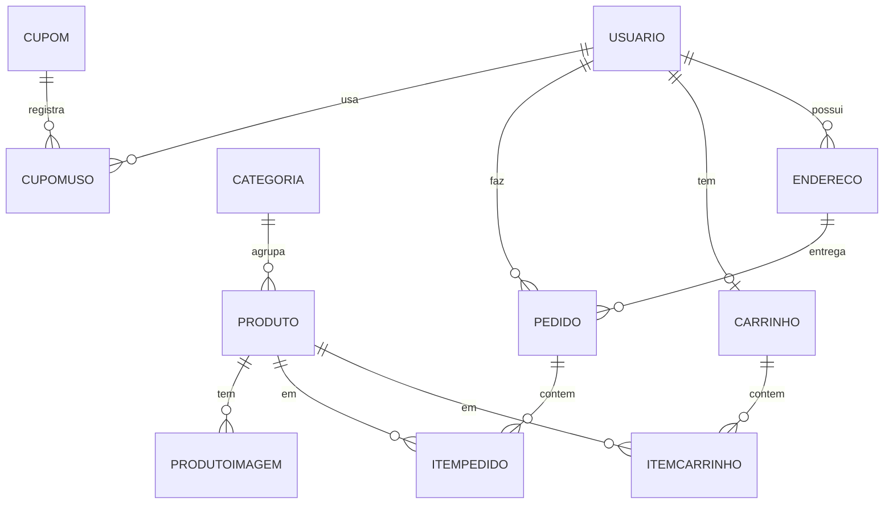

# Arquitetura e modelo de dados

## Visão geral

```
App mobile / Site / Admin  ──HTTP /api──▶  NestJS (esta API)  ──TypeORM──▶  MySQL
                                              │   ├──▶ Cloudinary (imagens de produto)
                                              │   ├──▶ PagBank (checkout hospedado)  ◀── webhook
                                              │   └──▶ SMTP (e-mail de pedido pago)
```

Cada domínio é um módulo Nest (`controller` + `service` + `entity`), importado em `AppModule`. O TypeORM usa `autoLoadEntities` e `synchronize: false`.

## Modelo de dados



Tabelas sem relação: `configsite` (chave/valor JSON).

| Tabela | Campos principais | Observações |
|---|---|---|
| `usuario` | nome, sobrenome, email, senha, cpf, telefone, sexo, dataNascimento, ativo, role | `email` e `cpf` únicos; exclusão é lógica (`ativo`) |
| `endereco` | rua, numero, cidade, estado, cep, usuarioId | Sem campos de bairro ou complemento |
| `categoria` | nome | |
| `produto` | nome, descricao, preco, estoque, categoriaId, marca, tamanho, composicaoMaterial, instrucaoLavagem, enviosDevolucoes, quantidadePorTamanho, ativo | `ativo` vira `false` quando o estoque zera na compra |
| `produtoImagem` | url, produtoId | `ON DELETE CASCADE` com o produto |
| `carrinho` | usuarioId (único) | Um por usuário |
| `itemcarrinho` | carrinhoId, produtoId, quantidade | |
| `pedido` | usuarioId, enderecoId, status, total, frete, desconto, totalFinal, tipoEntrega, cupomCodigo | Status: PENDENTE, PAGO, ENVIADO, ENTREGUE, CANCELADO |
| `itempedido` | pedidoId, produtoId, quantidade, preco | `preco` congela o valor da compra |
| `cupom` | codigo (único), tipo, valor, ativo, usoMaximo, usado | |
| `cupomUso` | cupomId, usuarioId | Único por par, garante um uso por conta |
| `configsite` | chave (única), valor (JSON) | Usa a chave `site-config` |

## Ciclo de vida do pedido

```
PENDENTE ──(webhook PagBank aprovado)──▶ PAGO ──▶ ENVIADO ──▶ ENTREGUE
    └────────────────────────────────────────────────────▶ CANCELADO
```

Apenas `PENDENTE → PAGO` é automático. As demais mudanças são manuais via `PATCH /pedidos/:id`, sem validação das transições.

## Decisões de projeto

- **O servidor é a fonte da verdade nos valores.** O checkout ignora preços e descontos do cliente e recalcula tudo, com lock pessimista no estoque.
- **Webhook seguro por segredo na URL**, comparado com `timingSafeEqual`, e idempotente (só altera pedidos `PENDENTE`).
- **Falha de e-mail não derruba o webhook.** O erro é registrado no log e a resposta ao PagBank segue normal.
- **Senhas** com bcrypt (custo 10), removidas de todas as respostas.
- **Decimais** (`preco`, `valor` de cupom) usam transformer para voltar como `number`.

## Testes

Há specs unitários de controllers e services (`*.spec.ts`) para `app`, `carrinho`, `categorias`, `enderecos`, `itemcarrinho`, `pedidos`, `produtos` e `usuarios`, mais `test/app.e2e-spec.ts`. Não há testes para `auth`, `cupons`, `pagamentos`, `itempedido`, `produto-imagem` e `site-config`.
